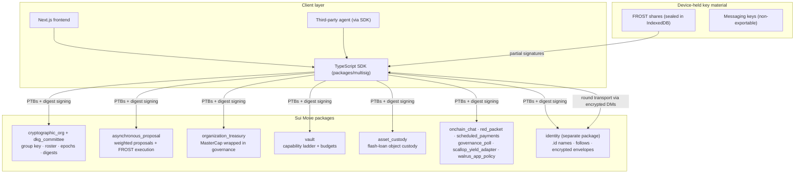

# Sui Multisig — Technical Whitepaper

**Group-chat-native on-chain organizations with FROST threshold custody and bounded agent spending.**

Version 0.1 · 2026-11-24 · Status: testnet, pre-mainnet, unaudited

> Every capability claim in this paper carries the project's status labels — **REAL** (verified on testnet with evidence), **LOCAL** (works locally / in tests only), **UNVERIFIED** (written and expected to work, not end-to-end verified), **GAP** (missing configuration or prerequisite), **NOT-DEPLOYED** (code exists, not on-chain). The authoritative claims ledger is [`docs/PRELAUNCH_CHECKLIST.md`](docs/PRELAUNCH_CHECKLIST.md); where this paper and the checklist disagree, the checklist wins. This document describes technology only; it is not investment advice and makes no market or revenue claims.

---

## Abstract

Sui Multisig is a protocol that turns a group chat into an on-chain organization. The organization is **not a multisig address**: its custody root is a FROST threshold key (t-of-n) whose private shares exist only on members' own devices, while the chain holds only the group public key, a weighted roster, and governance state. Members change without changing the organization's address — membership transitions run as key resharing, and the address (derived from the group public key) stays fixed.

On top of the organization sit three capabilities that ordinary multisig wallets do not offer:

1. **Bounded agent spending.** The holder of a vault's master capability can issue spending authority to software agents with per-agent epoch budgets, a vault-level epoch outflow cap, and a deny-by-default policy. An agent can never exceed its budget through its own capability and never holds the master capability or any extractable secret. This operates on *open* vaults; it does not currently compose with the governed treasury of the next point (§4.4).
2. **Governed custody of non-coin objects.** Any `key + store` object — an upgrade cap, an admin cap, a collectible — can rest in on-chain custody and leave only through weighted approval. Borrowing is a flash-loan primitive: a hot-potato receipt forces the object back into custody within the same transaction, so custody cannot leak.
3. **Identity and encrypted messaging as protocol infrastructure.** Free on-chain identities (`.id`), directed follows, bounded profiles, and ECDH-encrypted direct messages provide the transport over which FROST signing rounds are exchanged — and the social layer a group chat already implies.

The implementation is three packages: `contracts/agent_vault` (12 Move modules, ~7,340 lines, ~330 public functions), `contracts/identity` (360 lines, deployed on testnet 2026-10-29), and a TypeScript SDK (`packages/multisig`) shared by the Next.js frontend and external integrations.

---

## 1. Problem

Three user groups hit the same wall: shared money needs shared authority, but on-chain authority models are either too coarse or too manual.

**Group chats holding real funds.** Community treasuries, fan clubs, and work groups keep funds in one member's personal wallet. There is no audit trail, no permission model, and every payment is a favor — the group's money is one person's key.

**DAO membership changes.** On Sui, a native multisig address is derived from the exact set of member public keys, weights, and threshold. Change the roster and you change the address; funds must be migrated, and every integration that references the old address breaks. Real organizations change members constantly — joining, leaving, suspension, rotation.

**Software agents that spend.** Agentic payment protocols (HTTP-402-style machine payments) give an agent a wallet, but the wallet's key is either the user's key (unbounded risk) or a session key with at most a per-transaction cap and no organizational context. There is no native primitive for "this agent may spend up to X per epoch out of the group's treasury, and any request above X goes to the humans for a threshold vote".

The protocol addresses all three with one structure: the organization.

---

## 2. Design overview



The design is anchored on four primitives:

**The organization is a threshold key, not a multisig address.** `cryptographic_org` stores the group public key `group_pk`, a weighted roster (≤128 members), an epoch counter, a monotonic nonce, and a `key_generation` counter. The organization's on-chain account is the standard Ed25519 address derived from `group_pk` — so the DAO can receive funds, hold coins, and sign like any Sui account, except no single private key for it ever exists. The key is created by a distributed key generation ceremony (§4.1) and its shares live on member devices.

**Authorization is digest-scoped, not message-scoped.** Every threshold-gated action (treasury transfer, roster update, epoch advance, key rotation, DKG attestation) is signed over a SHA-256 digest built from a unique ASCII domain constant plus BCS-encoded, chain-bound fields (`chain_id`, `org_id`, epoch, nonce, action payload, `key_generation`). Nine such digests are specified, with byte-exact layouts shared between the Move contracts and the SDK, pinned by golden vectors in CI. A signature authorizes exactly one action on exactly one chain for exactly one organization at exactly one key generation — replay across actions, chains, epochs, or key generations is structurally rejected.

**Spending authority is a capability ladder.** `vault` issues `MasterCap` (withdrawal + policy), `OperatorCap` (agent management, no withdrawal), and `AgentCap` (spending credential) as Move capabilities with deliberately restricted abilities (`key` without `store` on the latter two — they cannot be wrapped, nested, or transferred through public framework operations). Below budget, an agent spends in one PTB call with automatic per-epoch accounting; at or above budget the call aborts. There is no path by which an agent reaches the master key or an unlimited spend. Governance by threshold signature and agent budgets are enforced on *different* vault objects in the current contracts: the governed treasury seals its master capability and therefore cannot issue agent authority, while an agent-enabled vault keeps a master-capability holder who can withdraw unilaterally (§4.4).

**Custody is atomic or it doesn't happen.** `asset_custody` holds non-coin objects as dynamic object fields keyed by `(TypeName, slot)`, preserving object IDs and indexability. Withdrawal is approval-gated; borrowing returns an undroppable `CustodyReceipt` that the transaction must hand back, so a borrowed asset is a flash loan — an unreturned borrow aborts the entire transaction.

---

## 3. Architecture

### 3.1 The three packages

| Package | Contents | Status |
|---|---|---|
| `contracts/agent_vault` | 12 modules: `vault`, `cryptographic_org`, `dkg_committee`, `asynchronous_proposal`, `organization_treasury`, `asset_custody`, `governance_poll`, `onchain_chat`, `red_packet`, `scheduled_payments`, `scallop_yield_adapter`, `walrus_app_policy` | Deployed on testnet, lineage `0x73afe159…` (fresh publish, version 1) — REAL |
| `contracts/identity` | `identity`: names, profiles, follows, encrypted message envelopes, object inbox | Deployed on testnet 2026-10-29 (`0xba0780e7…`) — REAL |
| `packages/multisig` | SDK: `agent-vault/*` (org, finance, custody, committee, proposal, chat, polls, scallop, app-policy), `dkg`, `account`, `namespace`, `bridge` | Used in production frontend — REAL |

The SDK is the single source of PTB construction and digest computation. The frontend injects platform concerns (IndexedDB, device keystores, wallet signing, environment) through interfaces, so the same SDK runs in the Next.js app, in offline tests, and — intended — in third-party agents.

### 3.2 Trust boundaries

The internal security review (§6) maps five boundaries; three are verified sound, two are known open:

1. **Off-chain ↔ on-chain digest construction** — the SDK's `digest.ts` and the Move digest constructors must agree byte-for-byte. Verified: nine digests compared field-by-field, byte layouts identical, golden vectors enforce it in CI.
2. **Member majority ↔ FROST key holders** — on-chain voting only decides whether the weighted threshold is met; the *only* authorization source for execution is a valid threshold signature under the current `group_pk`. Verified sound.
3. **Governance ↔ treasury root authority** — `organization_treasury` wraps the vault's `MasterCap` inline inside a key-only shared object. No public seam can extract it; payouts flow only through organization-approved proposals. Verified sound. The same seal means a treasury cannot set an outflow policy or issue operator and agent cards.
4. **Chain ↔ privacy/attribution** — DKG mailboxes and message events hold ciphertext only; the chain cannot attribute a ciphertext to a sender (no sender signature on envelopes). Known limitation (§7).
5. **Deployment surface** — the current lineage's `UpgradeCap` is held by a single address. Known open risk, first gate on the roadmap to mainnet (§8).

### 3.3 Upgrade policy

The project evolves by **fresh publish**: each new package starts a new lineage at version 1, with the SDK constant pointing to the current package, rather than by in-place upgrades. Rationale: fresh publishes keep type domains self-contained and avoid carrying compatibility constraints across security-sensitive changes. The trade-off — the previous lineage freezes — is accepted deliberately, and the bootstrap runbook (`docs/BOOTSTRAP_PRODUCTION_RUNBOOK.md`) defines the custody path for a mainnet lineage's upgrade capability before funds matter.

---

## 4. Protocol details

### 4.1 Organization creation: asynchronous DKG with threshold attestation

`dkg_committee` runs a two-round Gennaro/Feldman DKG over Ed25519 (RFC 9591 semantics on the client):

1. **Session** — anyone creates a session with a threshold, participant set (duplicates and zero addresses rejected), deadline (10 minutes – 7 days), and a **fixed bond of 0.05 SUI** per participant (the contract reserves a 0.05–0.5 SUI range for future configurability), plus a **0.005 SUI creation fee that is burned**.
2. **Round 1** — participants submit Feldman commitments on-chain.
3. **Round 2, sealed mailboxes** — each participant registers an encryption key (X25519 32 B or P-256 65 B) and deposits every share encrypted to its recipient; payload bounded at 2048 B. Members do not need to be online simultaneously: each completes their rounds within the deadline window.
4. **Confirmation & attestation** — recipients verify shares against commitments and confirm; then each of at least `threshold` confirmed members **attests** the group public key they recomputed locally from the on-chain commitments.
5. **Finalization** — `finalize_session` accepts a group key only when `threshold` distinct confirmed participants attest the *same* key, then the organization is created with the attested key and a 90-day hard-locked genesis stake.

The attestation step is the protocol's answer to a **critical vulnerability found and fixed during development**: the original `finalize_session` accepted any caller-supplied 32-byte public key, and its v2 successor verified a signature *under the caller's own chosen key* — circular, exploitable, and reachable on deployed bytecode. The fix moved finalization to threshold attestation: forging a key now requires controlling a threshold of confirmed participants, which is exactly the DKG trust assumption. The vulnerability, its on-chain reachability evidence, the fix, and the follow-up duplicate-participant escalation found during review are documented with test pins in `docs/PRELAUNCH_CHECKLIST.md` (Appendix 2). On the earlier upgraded lineage the fix shipped as `finalize_session_v3`; the current fresh lineage carries it under the plain name.

Bond economics: a timed-out session refunds bonds in full (no slashing) and refunds any voluntary overpayment ("genesis stake") through `claim_stake` — the fix for review finding H-02. One path is still open. The marker that stops a session from being redeemed twice (`mark_org_created`) is `public` instead of package-visible, so anyone can write it on any session. A session that is then finalized can neither become an organization (the marker is permanent) nor time out (finalized sessions are refused), so its genesis stakes are locked; bonds remain claimable.

### 4.2 Governance: weighted proposals, FROST execution

`asynchronous_proposal` + `cryptographic_org` implement decisions:

- Any member proposes a treasury transfer with a title (≤256 B), deadline (≤365 days), recipient, amount, and funding vault. Voting snapshots the epoch, roster weights, and threshold at creation.
- Members vote (approve/reject) with their **live roster weight**; delegated voting exists through `SubagentCoSignCap` — a co-sign credential with a per-day budget; the internal review records that a cast co-sign vote stays in place after the credential is revoked (finding M-02, §8).
- Execution calls `execute_transfer_proposal`, which verifies the FROST signature over the **V3 treasury transfer digest** (domain `SUI_ORG_TREASURY_TRANSFER_V3:` binding chain, org, epoch, nonce, proposal, recipient, amount, **vault_id**, **key_generation**), then splits and transfers funds. The digest binds the funding vault so a signature cannot be replayed against another vault, and binds `key_generation` so a signature minted before a rotation is dead after it.

The execution nonce is strictly monotonic per organization; every digest embeds it; and each executed digest is recorded, so no executed action can be replayed even with a fresh signature.

### 4.3 Membership changes: resharing versus rotation

The protocol separates two operations explicitly (`docs/RESHARING_SECURITY.md`):

| | `advance_organization_epoch` (resharing) | `rotate_group_key` (rotation) |
|---|---|---|
| Underlying mechanism | Gennaro proactive resharing | Fresh FROST DKG output |
| Group public key | unchanged | replaced |
| Address | unchanged | **changes** |
| Erasure assumption | removed members must delete old shares | none |
| Use case | routine turnover, threshold adjustment | expulsion of a hostile member, suspected compromise |

Resharing cannot cryptographically revoke a member who keeps their old share — this is stated as a design limitation, not hidden: any signature the old coalition can produce under the old key remains valid until a rotation. Rotation closes the window: `rotate_group_key` requires (a) a threshold signature under the *current* key over a V3 digest binding the new key, the new signer roster, and the new threshold; (b) a **proof-of-possession signature under the new key**, bound to the organization and the epoch it produces; and (c) it increments `key_generation`, which instantly invalidates every outstanding V2-domain signature from old shares.

### 4.4 Agent vaults: bounded delegated spending

`vault` implements the capability ladder:

- `MasterCap` (has `key, store`) — withdrawal, outflow policy, agent management, emergency purge. In the treasury pattern it is wrapped by `organization_treasury` and lent to exactly one operation: executing an approved transfer.
- `OperatorCap` (`key`, no `store`) — issue/manage agent cards, set budgets, pause/resume. **Cannot withdraw.**
- `AgentCap` (`key`, no `store`) — held by the agent's address; the authoritative state (budget, spend, active flag, service hash) lives in the vault's inline bounded table (≤100 agents), not on the card, eliminating dual-source drift.

Spending (`spend_x402_budget`) is one PTB call that checks the vault circuit-breaker and card binding, auto-resets the agent's counter on epoch rollover, enforces `spent + amount ≤ daily_budget`, enforces the vault-level `epoch_outflow ≤ max_epoch_outflow`, then splits and pays. An over-budget call aborts; the agent holds no capability that reaches beyond its budget. The recipient of a spend is any non-zero address — the service hash on the card is recorded, not enforced. `set_outflow_policy` is **deny-by-default**: until the master sets limits, no agent can be issued or spend. `pause_agent` / `emergency_unilateral_purge` provide operational circuit breakers, and every outflow path emits an event for monitoring (`docs/DEPLOYMENT_RUNBOOK.md` §5 gives the alerting rules).

Two boundaries are stated rather than buried. First, the master's own withdrawals debit the same epoch-outflow counter and are bound by the cap once a policy is set (the fix for review finding M-01); with no policy set they are unlimited, because the master must be able to recover what was deposited. The emergency purge is deliberately not rate-limited and pins the counter to the cap so that monitoring alerts. Second, **agent authority and governed custody do not compose**: `set_outflow_policy` and `issue_operator_cap` both require the `MasterCap`, which the organization treasury seals. A treasury vault therefore never issues an agent card, and an agent-enabled vault always has a master-capability holder who can move funds alone. In the current contracts, agent vaults are an account-level mechanism, not an organization-treasury one.

### 4.5 Asset custody: coins and everything else

`asset_custody` is the treasury for non-coin value — upgrade caps, admin caps, collectibles. Deposits are dynamic object fields keyed by `(TypeName, slot)` (≤64 live types × ≤128 slots), so every custodied object keeps its original ID and remains independently readable. Two terminal operations, both running the same proposal mechanics as SUI transfers (live-roster weights, snapshotted threshold, deadline, one decision per member):

- **RELEASE** — transfer to the recipient frozen at proposal creation; anyone may relay the execution.
- **BORROW** — `take_asset` returns the object plus an abilities-less `CustodyReceipt`; the PTB may use the object freely (e.g. `authorize_upgrade` → native `Upgrade` → `commit_upgrade`) but must `return_asset` the exact object into the same slot in the same transaction. The receipt cannot be dropped, stored, or transferred, so an unreturned borrow aborts atomically. A borrow approval additionally expires five minutes after proposal creation, so an approval cannot stay armed.

### 4.6 Identity and messaging

`contracts/identity` (360 lines, 48 tests, 99.15% bytecode coverage, deployed on testnet) provides:

- **Names**: exactly one permanent, non-transferable `.id` per address, free (gas only), label 3–32 ASCII bytes, rename preserves object ID, social edges, and inbox. Registry ceiling 10⁹, no iteration paths, no admin cap, no fee, no pause, no recovery override — authority is native ownership of the `Name` object, nothing else.
- **Social graph**: directed follows capped at 1000 outgoing per identity, stored on-chain; reverse (followers) is reconstructed off-chain from `Followed`/`Unfollowed` events in ledger order, bounded (last 1000 per module stream) and labeled truncated when the scan caps out — never presented as a complete index.
- **Encrypted direct messages**: client-side P-256 ECDH + HKDF-SHA256 + AES-256-GCM, fresh ephemeral key per message, separate sender/recipient ciphertexts, on-chain authentication of the sending identity and rejection when the recipient's registered key changed mid-flight (rotation race aborts). Plaintext ≤1000 UTF-8 B (an SDK limit; the chain bounds only the ciphertext, at 4,112 bytes). The chain sees only envelopes; there is no delivery acknowledgment, no spam filter, no metadata confidentiality, and no forward secrecy — stated limits.
- **Payments to identities**: transferring an object to the address equal to a Name's object ID delivers it to the identity's inbox (Sui native `Receiving`); the owner extracts to any address. Resolving a label to pay must happen at transaction time — labels are reclaimable after rename.

Two transports carry FROST rounds between members: manual public-JSON exchange, and encrypted identity DMs. Both are wrapped by the SDK's `multisig/bridge` (`createPrivateMessaging`, `createFrostDmTransport`), with injected stores and signers so the same code runs in the browser and offline; a two-node end-to-end test (request → round 1 → transcript → round 2 → aggregate → verify) runs in CI. Real multi-device transport over a deployed network remains **UNVERIFIED** — the largest single open item (§8).

### 4.7 Chat and membership economics

`onchain_chat` is the substrate the rest assumes: shared channels with a monotonic `message_sequence`, a preview and a Walrus blob ID per message (bounded to 4096 B and 128 B on the batch entry point; the single-message entry points enforce no bound), membership with a refundable stake, and a per-message gas rebate:

- **Gas rebate**: each sent message pays the sender a fixed **0.001 SUI** from the channel's subsidy pool, when the pool holds it. The pool starts empty and is filled only by yield deposits (`deposit_staking_yield`, callable by anyone). **No yield source is implemented**: the contract stakes nothing — the creator's and members' stakes sit as idle balances, returned in full on exit — and the Scallop adapter meant to feed yield is a simulation (§4.8). Until a real yield source exists, the rebate is a distribution of deposited funds.
- **Batching**: up to 32 messages per PTB, one wallet signature, one subsidy transfer (`post_message_batch`); the frontend ABI-probes and falls back to per-message PTBs automatically.
- **Membership pricing**: paid-entry channels ("ticket" to the creator) plus a refundable principal stake; a member leaving redeems 100% of principal plus yield-weighted dividends **accrued only after their join** — the accumulator/debt snapshot accounting makes "join, harvest the banked pool, leave" impossible.
- **Creator revenue**: entry fees, plus a share of any deposited yield. The split is set by the creator in basis points at channel creation (the contract's documented example is 70% creator / 20% gas pool / 10% members); a plain staked channel routes 100% of deposited yield to the gas pool. Channel dissolution returns principal in full.
- **Subagent messaging caps** (`SubagentMessagingCap`): the human shares a channel-scoped session key capability so a local agent can post without signing every message — rate-limited, revocable, kill-switchable on-chain.

### 4.8 The rest of the application layer

| Module | What it does | Notable constraint |
|---|---|---|
| `scheduled_payments` | Fully-funded streams with vesting curves and prepaid recurring plans; per-installment approval caps | No keeper promised — someone must submit each execution transaction |
| `red_packet` | Channel-scoped escrow with equal or random allocation, expiry refunds | Conservation is explicit (`initial = claims + escrow + refunded`); randomness is framework-sealed, creator cannot pre-learn the allocation, and failed claims reveal nothing |
| `governance_poll` | Advisory polls: single-choice, multi-approval, full Borda ranking; weights snapshotted from the org roster | Grants **no** asset authority; a tie stays a tie |
| `scallop_yield_adapter` | Yield bookkeeping intended to feed chat economics | **A simulation**: depends only on the Sui framework and holds a local placeholder coin type, so it cannot receive real sSUI and routes no production yield. Facts-of-record are actual coin values received/sent, never caller-declared numbers |
| `walrus_app_policy` | Stake-gated SUI payment policies for registered apps (per-payment cap, per-epoch budget) | Admin compromise can manage its own registry but cannot touch membership deposits or redirect payments |

---

## 5. Cryptography

All primitives are standard and mapped to their specifications and attack literature in `docs/CRYPTO_LITERATURE_INDEX.md`:

| Primitive | Instance |
|---|---|
| Signatures | Ed25519 (RFC 8032) on-chain verification; FROST two-round threshold Schnorr (RFC 9591) for group signing |
| Key generation | Gennaro/GJKR DKG with Feldman VSS commitments; dealer honesty enforced by an off-chain Schnorr proof-of-knowledge bound to org, epoch, session, and the dealer's previous verification share |
| Device key protection | FROST nonces and DKG shares sealed with a non-extractable AES-256-GCM device key before touching IndexedDB; zkLogin ephemeral keys likewise; nonce consumption is a synchronous, atomic, single-use IndexedDB commit |
| Transport encryption | X25519 + HKDF + AES-256-GCM (SDK), P-256 variant (browser ritual path); AAD binds session and both parties |
| Digests | SHA-256 over domain-separated, BCS-encoded, chain-bound fields; golden vectors pin every layout |

**Verified conclusions** (2026-11 attack-simulation pass, reproducible via `scripts/rt-lit-*.ts`, 0-gas simulations): concurrent-session forgery at the ePrint 2025/1001 bound is unreachable (binding factors include the message and group key; UI serializes sessions); signature malleability is dead on-chain (s+L rejected, E_CODE 1010) and irrelevant to authorization (digests, not signature bytes); cross-session binding-factor substitution is infeasible; BCS concatenation ambiguity exists in principle but has no exploitable path (distinct-key PoP verification fails; digest dedup); GCM replay has zero information gain; key-reuse edges across wallet/shares/attest keys are all closed or degraded; side channels are unreachable in the browser threat model but **must be re-evaluated** if signing moves server-side. Remaining open surfaces are listed in the index's "open questions" (P-256/X25519 dual-stack confusion; DKG griefing cost quantification; several literature comparisons).

**Formal models** (`formal/org_governance`): a TLA+ model of the governance state machine (7 invariants — governance covers the key threshold, rotation binds the new key, epoch advance binds `key_generation`, nonce monotonicity, genesis-stake hard lock, no signer outside governance, advance survives resharing — over 4,968 reachable states, with two deliberately broken configurations reproducing violations at shortest counterexample length) and an Alloy model asserting digest field-binding and authorization closure (8 checks counterexample-free, 4 runs instance-nonempty). Known-excluded from formal scope: dealer honesty (off-chain by construction), curve arithmetic, BCS layouts (covered by golden vectors).

---

## 6. Security posture

**Process evidence.** The codebase has been through ten rounds of internal adversarial review (35+ findings, all closed), one internal white-box security review (`docs/SECURITY_REVIEW.md`), a critical-vulnerability discovery→fix→deploy→re-review cycle with on-chain evidence (§4.1), and a formal-model pass. Test gates at the time of writing: **527/527** Move tests, **48/48** identity tests, **735/735** frontend offline tests, **177/177** SDK tests, TypeScript clean, ESLint 0 errors / 0 warnings, golden vectors zero-drift in CI, production build passing with CSP (`default-src 'self'`, `object-src 'none'`, `frame-ancestors 'none'`), `Referrer-Policy: no-referrer`, `X-Content-Type-Options: nosniff`, and `X-Frame-Options: DENY` verified on pages, API routes, and 404 paths. Two gaps in the gates themselves: CI runs the Move tests for `agent_vault` only, so the identity package's 48 tests are not exercised, and its frontend gate omits the test files under `lib/crypto` and `lib/i18n`.

**Open findings** (internal review, severity-ranked; full detail in `docs/SECURITY_REVIEW.md`):

- **H-01 (High, deployment)** — the current lineage's `UpgradeCap` is held by a single address, unsealed. Until it is sealed into threshold custody with a *persistent* share set, the upgrade path is a single point of compromise. First mainnet gate (§8). The prior lineage's cap was sealed into a governance wrapper but its bootstrap shares were never persisted, permanently freezing that lineage — the operational lesson is encoded in the bootstrap runbook.
- **H-02 (High, fund lock)** — fixed in the current sources: timed-out sessions refund genesis stakes through `claim_stake`. A residual path is not yet in the review: the public `mark_org_created` marker locks the stakes of any session finalized after being marked (§4.1).
- **M-01** — fixed in the current sources: master withdrawals debit the same epoch-outflow counter and are bound by the cap once a policy is set. **M-02** — per the review, a subagent co-sign vote is irreversible after the credential is revoked. Plus four Low and four Informational findings, all documented with locations and fix paths.

The review document itself (`docs/SECURITY_REVIEW.md`) still lists H-02 and M-01 as open, and still documents the superseded V2 layout of the treasury-transfer digest; it lags the code.

**No third-party audit exists yet.** The audit scope package (`docs/THIRD_PARTY_AUDIT_SCOPE.md`) defines the target, mandatory risk areas, deliverables, and evidence bundle. Until an independent report lands, the project must be described as *unaudited*, and neither this paper nor any other material may claim otherwise.

One engineering item belongs on the same list. The SDK carries two FROST implementations. The bridge path uses noble's `ed25519_FROST`; the organization proposal session uses a project-specific one whose binding-factor construction is not wire-compatible with RFC 9591 and which does not check that the signer's own commitment is the one in the transcript (RFC 9591 §5.2). No exploit of the omission has been established; it is a reason to converge on one implementation.

---

## 7. Known limitations

Stated plainly, because a protocol that hides its boundaries is worse than one that states them:

- **Threshold liveness is existential.** If `t` shares become unavailable (lost devices, lost seed phrases), funds are stranded. There is deliberately no personal recovery authority — that is the cost of "no single point"; the mitigation is proactive resharing cadence and share backup discipline, both operator responsibilities.
- **Resharing is not revocation** (§4.3). Expelling a hostile member requires a rotation, which changes the address.
- **No sender attribution on ciphertexts.** Mailboxes and message events cannot prove who encrypted a payload; a spammer can waste a recipient's decryption effort (bounded: payloads ≤2048 B, VSS verification rejects garbage). Sender-signed envelopes are a listed open item.
- **DKG griefing is priced but not punished.** Bonds refund in full on timeout, so forcing a session to deadline costs the griefer only gas. Quantifying and pricing this is an open item.
- **Messaging privacy is envelope-only.** No forward secrecy, no metadata confidentiality, no delivery guarantee, no spam filtering; complete history requires an external indexer.
- **The chat rebate has no funding source yet.** The 0.001 SUI/message rebate is paid from a pool that only receives deposits, and nothing in the contracts generates yield; in practice the pool is empty and chat costs gas as usual.
- **Agent vaults are not organization vaults.** The master-capability seal that protects the governed treasury also prevents it from issuing agent cards (§4.4).
- **Browser threat model only.** Constant-time guarantees are not claimed for the bigint arithmetic; the conclusion "side channels unreachable" is scoped to same-origin browser adversaries.

---

## 8. Status and the road to mainnet

**Where the project stands** (2026-11-24):

| Area | Status |
|---|---|
| `agent_vault` on testnet (12 modules, lineage `0x73afe159…` v1) | REAL |
| DKG endgame on-chain (3 real keystore accounts; attested key equals recomputed Σ C₀; threshold signature verifies against the on-chain key; DAO address funded, roster changed, real transfer executed) | REAL |
| Identity package on testnet, smoke-minted | REAL |
| Local FROST session recovery, nonce consumption, receipt binding (Chromium IndexedDB 9/9) | LOCAL |
| SDK bridge (offline two-node E2E) | LOCAL |
| Resharing on-chain (roster change with address invariance) | UNVERIFIED on-chain (REAL locally) |
| Real-wallet signing lifecycle, real multi-device FROST, live message indexing | UNVERIFIED |
| Mainnet deployment, production hosting | NOT-DEPLOYED |
| Third-party audit | GAP |
| Upgrade-cap threshold custody (current lineage) | GAP |
| Agent spending from an organization-sealed treasury | does not compose in the current contracts (§4.4) |
| Chat gas-rebate funding (yield source) | GAP — the adapter is a simulation |

**Ordered gates to mainnet** (from `docs/PRELAUNCH_CHECKLIST.md` §G and `docs/BOOTSTRAP_PRODUCTION_RUNBOOK.md`; no dates are promised, the order is the plan):

1. Close **H-01**: seal the mainnet lineage's `UpgradeCap` into threshold custody with *persisted* shares (encrypted device share store, rehearsed borrow-and-return of the cap, digest-independent artifact verification before every signature).
2. Restrict `mark_org_created` to package visibility and add a negative test (the residual fund-lock path, §4.1); bring `docs/SECURITY_REVIEW.md` in line with the code (H-02 and M-01 are fixed; the treasury-transfer digest is V3).
3. Resolve **M-02** (master override of subagent votes, or an explicit UX contract).
4. Decide how agent authority relates to governed custody — a governance-gated path for outflow policy and operator issuance, or an explicit statement that agent vaults are account-level — and give the chat rebate a real funding source, or describe it as donation-funded.
5. Real multi-device FROST acceptance: real devices, real wallet signing, deployed identity transport, live event indexing.
6. Independent third-party audit of both packages against the scope package; Critical/High findings fixed and re-reviewed.
7. Bootstrap rehearsal on testnet with the same cohort and devices that will run mainnet (DKG → org → custody deposit → borrow-upgrade → release), then mainnet publish under the same order of operations.
8. Only then: production hosting, monitoring per the runbook's event table, and the operational cadence (resharing schedule, key-rotation drills, digest-independent artifact verification).

---

## 9. Reproducing the claims

Every claim above maps to a command or artifact:

```sh
# Contract gates
cd contracts/agent_vault && sui move test          # 527/527 (2026-11-24)
cd contracts/identity  && sui move test            # 48/48, coverage 99.15%

# Application gates
pnpm sdk:typecheck && pnpm test:sdk                # SDK 177/177
pnpm exec tsx --test lib/*.test.ts lib/crypto/*.test.ts   # frontend 735/735
pnpm exec tsc --noEmit && pnpm lint && pnpm build

# Digest layout integrity (zero drift enforced in CI)
node scripts/golden-vectors-gen.mjs && git diff --exit-code -- \
  packages/multisig/src/agent-vault/org/digest-vectors.json

# Formal models
formal/org_governance/run.sh                       # TLA+ (TLC) + Alloy, see REPORT.md
```

On-chain evidence (object IDs, transaction digests, byte layouts) is quoted inline in `docs/PRELAUNCH_CHECKLIST.md`; on-chain read-only verification commands are listed in `docs/DEPLOYMENT_CHECKLIST.md` §6 and `docs/THIRD_PARTY_AUDIT_SCOPE.md` §5.

---

## Appendix A — Document map

| Part | Contents |
|---|---|
| Product & features | `docs/identity.md`, `docs/zklogin.md`, `docs/ui-feature-parity.md`, `docs/original-feature-review.md`, `docs/ux-content-plan.md` |
| Protocol & cryptography | `docs/RESHARING_SECURITY.md`, `docs/CRYPTO_LITERATURE_INDEX.md`, `docs/chat-cost.md`, `formal/org_governance/REPORT.md` |
| Security & audit | `docs/SECURITY_REVIEW.md`, `docs/THIRD_PARTY_AUDIT_SCOPE.md`, `docs/FROST_LOCAL_ACCEPTANCE.md`, `docs/PRELAUNCH_CHECKLIST.md` |
| Deployment & operations | `docs/DEPLOYMENT_CHECKLIST.md`, `docs/DEPLOYMENT_RUNBOOK.md`, `docs/BOOTSTRAP_PRODUCTION_RUNBOOK.md` |
| Internal working records | `docs/internal/` (review notes, working prompts, memo — not release material) |

## Appendix B — Identifiers (testnet)

| Object | Value |
|---|---|
| `agent_vault` package (current lineage, v1) | `0x73afe159f7b017efdfc7a013a6e444d54317b0147ae7fb182a182c3dc5ba57b5` |
| `agent_vault` UpgradeCap | `0xc4b50706bf89d1436006b84c091927095a7e32bb5fa7fed90c15b5eebe700310` (single-address, unsealed — GAP) |
| `identity` package | `0xba0780e7f08a0589c1f71c8b2eff10bfc6d498190c88d4d25292b502c7c9251e` |
| Shared `Names` | `0x25193e4ee41b0927cf0624421b50ed97e85cade5c617cf51e38e7eaec58d8294` |
| Sui framework pin | `8fc60f1fa966e90398c93beb67ad4f42992889c7` (`mainnet-v1.74.1`), toolchain `sui 1.82.1`, Move edition 2024 |

## Appendix C — Glossary

- **FROST** — Flexible Round-Optimized Schnorr Threshold signatures (RFC 9591): t-of-n parties jointly produce one ordinary Ed25519 signature; no single party knows the group key.
- **DKG** — Distributed Key Generation: the ceremony that creates the group key so that no one ever holds it whole.
- **Resharing** — changing (t, n) and the share holders without changing the group key or the address.
- **`key_generation`** — monotonically increasing counter bumped by every rotation; embedded in digests so pre-rotation signatures die with the old shares.
- **Epoch** — Sui's global clock unit; per-epoch accounting (agent budgets, outflow caps, app budgets) resets automatically on rollover.
- **PTB** — Programmable Transaction Block: Sui's atomic multi-command transaction; custody borrow/return and batched sends are single-PTB constructions.
- **Capability (Cap)** — a Move object that confers authority by possession; ability restrictions (`key` without `store`) make caps non-transferable, non-wrappable credentials.
- **Hot-potato receipt** — a value with no abilities that must be consumed in the same transaction; the mechanism that makes custody borrow atomic.
- **Fresh publish** — releasing a new package lineage (new original ID, version 1) instead of upgrading in place; the project's upgrade policy.
