# agent_vault 内部安全评审报告（Internal Security Review）

- 审计对象：`contracts/agent_vault/sources/`（12 模块，7,808 行 Move）
- 评审类型：内部源码评审（白盒，定向核查 + 抽查，AI 辅助完成、结论逐条对照源码核对），未含形式化验证
- 报告版本：v1.1（2026-11-24）。v1.0 发布后源码经历了一轮修复，本版按当前源码逐条复核：已修复的条目在标题下标注「状态（v1.1）」，正文保留 v1.0 原文；新发现列在 §4.8；摘要布局与测试数字全部更新，附录里三个算错的字节数也已订正
- 依据基线：Move 单元测试 527/527 全绿（2026-11-24 实测）；10 轮定向攻击核查、35+ 发现全部闭环（本报告不重复计分，仅在残余风险中复述未闭环项）
- 结论摘要：**有条件通过**。v1.0 的两项 High 里，资金锁定路径（H-02）与复核时发现的同类路径（H-03）都已在源码中闭环；部署面的 H-01 仍未闭环，是上主网前的一票否决项，详见 §6。本轮修复都只在源码里，不在任何已部署的包里

---

## 1. 范围与方法

### 1.1 范围

| 类别 | 内容 |
|---|---|
| 源码 | `vault`、`cryptographic_org`、`dkg_committee`、`asynchronous_proposal`、`organization_treasury`、`asset_custody`、`governance_poll`、`onchain_chat`、`red_packet`、`scheduled_payments`、`scallop_yield_adapter`、`walrus_app_policy` |
| 客户端摘要实现 | `packages/multisig/src/agent-vault/org/digest.ts`、`bcs.ts` |
| 既有材料 | `docs/THIRD_PARTY_AUDIT_SCOPE.md`、`docs/PRELAUNCH_CHECKLIST.md`、`docs/RESHARING_SECURITY.md` |

### 1.2 方法

1. 以 `transfer::public_transfer`、`balance::split`、`withdraw`、`dynamic_field::remove` 为锚点枚举**全部资产出口**，逐个回溯到授权断言，而不是逐行通读。
2. 以域常量（`DOMAIN_*`）为锚点，把 Move 侧 11 个摘要构造函数与 SDK `digest.ts` 的拼接顺序、编码逐字段对照；自 v1.1 起由同一组 golden vector 在 CI 里两侧持续比对（§3.7）。
3. 对状态机模块（proposal / custody / dkg）核对 `status` 迁移、快照字段与执行期实时字段的一致性（TOCTOU 检查）。
4. 对 hot potato、动态字段键、共享对象身份绑定做人工可满足性分析。
5. 抽查读入规模上界（VecMap / Table / 消息体）以确认无无界存储写入。v1.0 在这一步只抽查了聊天的批量入口，漏掉了单条入口（见 I-03 与 M-05）。

### 1.3 明确未覆盖（不在本报告担保范围内）

- **无形式化验证**：未对摘要编码、FROST 聚合验签、状态机做机器证明；本报告结论为逐条源码核对推理。（独立的形式化模型见 `formal/`。）
- **非独立第三方审计**：本报告为内部评审，与 `docs/PRELAUNCH_CHECKLIST.md` 中「第三方审计 GAP / UNVERIFIED」的口径一致；独立第三方审计完成前，本报告不可作为外部审计意见引用。
- **无主网部署验证**：未对主网字节码/ABI/对象布局做比对；`Published.toml` 记录的是测试网 lineage，源码与已部署字节码的一致性未验证。
- 未做链上模糊测试、未做 gas/存储成本分析、未审 `packages/multisig` 其余业务代码、未审前端与密钥管理。
- 未评估密码学原语实现本身（FROST/DKG 正确性依赖客户端库，链上只做 ed25519 验签与小阶点拒绝）。

---

## 2. 资产流图与信任边界

### 2.1 资产流图

```mermaid
flowchart LR
    subgraph P0["持有人 / 成员"]
        M[MasterCap 持有者]
        MEM[组织成员<br/>members+weights]
        AG[Agent 卡<br/>AgentCap]
        SB[Subagent 协签<br/>SubagentCoSignCap]
    end

    subgraph V["agent_vault::vault"]
        BAL[(Balance&lt;T&gt;)]
        POL[max_epoch_outflow<br/>max_agent_budget]
    end

    subgraph GOV["cryptographic_org + async proposal"]
        ORG[Organization<br/>group_pk / epoch / key_generation / nonce]
        PROP[Proposal<br/>accumulated_weight ≥ threshold]
        FROST[FROST 聚合签名<br/>Ed25519 verify]
    end

    subgraph T["organization_treasury"]
        TR[OrganizationTreasury<br/>内联 MasterCap]
        BIND[TransferBinding<br/>treasury_id + proposal_id]
    end

    subgraph C["asset_custody"]
        INV[(dynamic_object_field<br/>按 TypeName+slot 索引)]
        REC[CustodyReceipt<br/>无 abilities]
    end

    subgraph OTH["外围价值流"]
        DKG[DkgSession<br/>bond + genesis stake]
        PAY[scheduled_payments]
        RP[red_packet escrow]
        CHAT[onchain_chat 质押/收益]
        SCA[scallop adapter<br/>admin 中继]
    end

    M -->|withdraw：记账 epoch_outflow，设过策略即受上限约束| BAL
    AG -->|spend_x402_budget<br/>日额度+epoch 流出| BAL
    MEM -->|投票/驳回| PROP
    PROP -->|threshold 达成| FROST
    FROST -->|nonce 单调 + 摘要绑定| PROP
    PROP -->|execute_transfer_proposal| BAL
    TR -->|execute: 校验 binding| BIND
    BIND -->|proposal 身份绑定| PROP
    TR -->|内联 MasterCap 调用 withdraw| BAL
    FROST -->|delegate_agent_authority / set_agent_outflow_policy| POL
    INV -->|take_asset 借出原子窗口| REC
    REC -->|return_asset 同事务| INV
    INV -->|execute_release| RCV[proposal.recipient]
    MEM -->|bond / stake| DKG
    DKG -->|claim_bond 仅本人| MEM
    DKG -->|take_genesis_stakes<br/>public(package) 扫入| ORG
    PAY -->|claim / execute_installment| RCV
    RP -->|claim_equal / claim_random| MEM
    CHAT -->|收益分润 / 退群清算| MEM
    SCA -->|record_principal_redemption<br/>admin 自报 ssui_burned| MEM
```

### 2.2 信任边界图

```mermaid
flowchart TB
    subgraph TB1["边界 1：链下 ↔ 链上（摘要拼接）"]
        SDK["SDK digest.ts<br/>chain_id/org/epoch/nonce/…"]
        MV["Move 摘要构造函数<br/>bcs::to_bytes 拼接"]
        SDK <-->|必须逐字节一致| MV
    end

    subgraph TB2["边界 2：成员多数 ↔ FROST 密钥持有者"]
        VOTE["异步投票<br/>链上实时名册权重"]
        KEY["FROST 签名者集合<br/>key_signers / key_threshold"]
        VOTE -->|只决定门限是否达标| EXEC
        KEY -->|唯一签名授权来源| EXEC[execute_transfer_proposal]
    end

    subgraph TB3["边界 3：组织治理 ↔ 金库根权限"]
        TRU["OrganizationTreasury<br/>MasterCap 不可独立寻址"]
        RAW["裸 AgentVault<br/>MasterCap 由 EOA 持有"]
        TRU -->|只能经门限签名：execute / 授权 / 策略调整| VAULT[(vault 余额)]
        RAW -->|MasterCap 即根权限| VAULT
    end

    subgraph TB4["边界 4：链上 ↔ 链下隐私/中继"]
        MAIL["DKG mailbox 密文 2048B 上限"]
        STAKE["attest 签名 = Round-1 公布钥真签名"]
        CHAIN[("链上只存密文，<br/>无解密/无发送方签名归责")]
        MAIL --- CHAIN
        STAKE --- CHAIN
    end

    subgraph TB5["边界 5：部署面"]
        CAP["UpgradeCap 托管方式<br/>（源码范围外）"]
        OPS["运维密钥 / RPC / 前端"]
    end
```



**边界判定**：TB1、TB2、TB3 是本次审计确认的**有效**安全边界（TB3 在 v1.0 只验证了封印破不了，没有注意它同时把 Agent 授权也封死了，见 M-03）；TB4 的发送方归责明确缺失（见 §5）；TB5 是当前**最薄弱**的一环（见 H-01）。

---

## 3. 摘要域分离逐字节布局

以下 6 个摘要为资产授权的直接依据（转账、提案、纪元推进、密钥轮换、Agent 授权、流出策略），全部采用 `SHA-256`，域字符串以原始 ASCII 字节前置、无长度前缀；`bcs(ID)` 在 Sui 中等价于 32 字节地址。另 5 个摘要（PoP 两个、名册换届、创世质押提取、DKG 背书）列在 §3.4 之后。

### 3.1 国库转账 `SUI_ORG_TREASURY_TRANSFER_V3:`（`asynchronous_proposal.move:568` ↔ `digest.ts:167`）

| # | 字段 | Move 序列化 | SDK 序列化 | 字节数（testnet） |
|---|---|---|---|---|
| 1 | domain | `b"SUI_ORG_TREASURY_TRANSFER_V3:"` | `utf8(...)` | 29 |
| 2 | chain_id | `*chain_id`（原始字节） | `chainBytes()` | 12（`sui-testnet:`） |
| 3 | org_id | `bcs::to_bytes(org_id)` | `requireAddress` | 32 |
| 4 | epoch | `bcs(u64)` | `u64le` | 8 |
| 5 | nonce | `bcs(u64)` | `u64le` | 8 |
| 6 | proposal_id | `bcs(&ID)` | `requireAddress` | 32 |
| 7 | recipient | `bcs(&address)` | `requireAddress` | 32 |
| 8 | amount | `bcs(u64)` | `u64le` | 8 |
| 9 | vault_id | `bcs(&ID)` | `requireAddress` | 32 |
| 10 | key_generation | `bcs(u64)` | `u64le` | 8 |
| | **合计** | | | **201** |

V2 → V3 在 `amount` 之后追加了 `vault_id`。关键结论：`vault_id` 取自执行时传入金库的 `MasterCap` 所绑定的金库（`vault::master_vault_id`），同一份签名换一个金库即摘要改变、验签失败。`key_generation` 进入摘要，`rotate_group_key`（`cryptographic_org.move:776`）递增该值后，旧分片既签不出新摘要，旧摘要也因 nonce/代际不匹配无法重放，resharing 窗口被关闭。

### 3.2 门限提案 `SUI_ORG_THRESHOLD_PROPOSAL_V2:`（`cryptographic_org.move:538` ↔ `digest.ts:30`）

| # | 字段 | 编码 | 字节数 |
|---|---|---|---|
| 1 | domain | raw ASCII | 30 |
| 2 | chain_id | raw | 12（可变） |
| 3 | org_id | BCS ID | 32 |
| 4 | epoch_version | BCS u64 | 8 |
| 5 | nonce | BCS u64 | 8 |
| 6 | payload | **raw bytes，无长度前缀** | 可变 |
| 7 | action_type | BCS u8 | 1 |
| | **合计** | | **91 + len(payload)** |

关键结论：`action_type` 进摘要，签名即"动作类别"授权；payload 无长度前缀，但因后续仅 1 字节动作域且域串隔离，不存在结构性歧义（跨域碰撞被 domain 前缀排除）。

### 3.3 纪元推进审批 `SUI_ORG_EPOCH_ADVANCE_V2:`（`cryptographic_org.move:565` ↔ `digest.ts:57`）

| # | 字段 | 编码 | 字节数 |
|---|---|---|---|
| 1 | domain | raw ASCII | 25 |
| 2 | chain_id | raw | 12 |
| 3 | org_id | BCS ID | 32 |
| 4 | epoch_version | BCS u64 | 8 |
| 5 | nonce | BCS u64 | 8 |
| 6 | new_epoch_version | BCS u64 | 8 |
| 7 | key_generation | BCS u64 | 8 |
| | **合计** | | **101** |

### 3.4 密钥轮换 `SUI_ORG_KEY_ROTATION_V3:`（`cryptographic_org.move:513` ↔ `digest.ts:84`）

| # | 字段 | 编码 | 字节数 |
|---|---|---|---|
| 1 | domain | raw ASCII | 24 |
| 2 | chain_id | raw | 12 |
| 3 | org_id | BCS ID | 32 |
| 4 | epoch_version | BCS u64 | 8 |
| 5 | nonce | BCS u64 | 8 |
| 6 | new_group_pk | raw 32B（Move 侧未校验长度；SDK 侧 `requireDigest32`） | 32 |
| 7 | new_signers | BCS `vector<address>`：uleb 长度 + 32B×n | 1 + 32n |
| 8 | key_threshold | BCS u64 | 8 |
| | **合计** | | **125 + 32n**（n < 128） |

附录（同法核对，均一致，各有链上 golden vector 测试）：`SUI_ORG_POP_V2:`（`cryptographic_org.move:472` ↔ `digest.ts:115`）77+40n；`SUI_ORG_POP_V1:`（`:493` ↔ `:142`）99；`SUI_ORG_ROSTER_V1:`（`:590` ↔ `:200`）96+40n；`SUI_ORG_GENESIS_WITHDRAW_V1:`（`:746` ↔ `:233`）128；`SUI_DKG_ATTEST_V1:`（`dkg_committee.move:704` ↔ `digest.ts:340`）82，不含 chain_id，靠 session_id 唯一性隔离。（v1.0 把后三个中的 POP_V1、ROSTER_V1、GENESIS_WITHDRAW_V1 写成 92、141+40n、133，是算错了。）

### 3.5 组织金库 Agent 授权 `SUI_ORG_TREASURY_AGENT_V1:`（`organization_treasury.move:411` ↔ `digest.ts:264`）

| # | 字段 | 编码 | 字节数 |
|---|---|---|---|
| 1 | domain | raw ASCII | 26 |
| 2 | chain_id | raw | 12 |
| 3 | org_id | BCS ID | 32 |
| 4 | epoch | BCS u64 | 8 |
| 5 | nonce | BCS u64 | 8 |
| 6 | treasury_id | BCS ID | 32 |
| 7 | vault_id | BCS ID | 32 |
| 8 | operator | BCS address | 32 |
| 9 | max_epoch_outflow | BCS u64 | 8 |
| 10 | max_agent_budget | BCS u64 | 8 |
| 11 | key_generation | BCS u64 | 8 |
| | **合计** | | **206** |

### 3.6 组织金库流出策略 `SUI_ORG_TREASURY_OUTFLOW_V1:`（`organization_treasury.move:444` ↔ `digest.ts:303`）

与 3.5 同一绑定集，去掉 `operator`，域前缀 28 字节：**合计 176**。

关键结论：两个摘要共用组织的单调 nonce（与转账、纪元推进等所有门限动作同一个计数器），签名挪不到别的组织、别的 treasury、别的金库；纪元推进或名册换届后失效，密钥轮换后旧分片签出的授权失效。域前缀不同，同一份签名不能跨这两个动作。

### 3.7 核查结论

**SDK 与 Move 侧 11 个摘要逐字节一致，未发现编码歧义或字段顺序漂移。** v1.0 的这个结论来自一次性的人工逐字段比对；v1.1 起它由 CI 持续保证：

- SDK 侧：`scripts/golden-vectors-gen.mjs` 用 `node:crypto` 独立重算 12 个向量（11 个链上摘要，加 1 个 DKG mailbox 加密的 AEAD 关联数据），不引用任何 SDK 代码；`golden-vectors.test.ts` 逐个比对，CI 重新生成后 `git diff --exit-code`。
- Move 侧：`tests/digest_golden_tests.move` 与 `organization_treasury_tests.move` 里的两个测试把每个链上摘要在链上重算一遍，与同一组向量比对。为此 `asynchronous_proposal::compute_transfer_digest` 与 `dkg_committee::compute_attestation_digest` 改成了 public 纯函数（此前一个是私有函数，一个内联在 `attest_group_key` 里）。
- 两份拷贝不会走散：SDK 测试读取 Move 测试里引用的常量，要求与 JSON 相等；要求每个向量要么在链上重算、要么明确列为链下专用；并要求合约源码里出现的每个域字符串都在向量清单上，新加一个域必须先补向量。
- 变异验证：对 11 个摘要逐字段丢弃、相邻换位、换域，共 162 个变异，每个都被钉住该摘要的那一个测试杀死，没有波及其它测试。

两点保留意见（v1.0 的第三点「缺跨语言 golden vector」即 L-03，已闭环）：

- `bcs(ID)` 依赖 Sui `ID` 结构体单字段 `bytes: address` 的透明 BCS 编码，这一点在框架升级中若改变会静默破坏兼容性；
- SDK 侧 `bcsVectorAddress` 要求调用方传入完整 32 字节 hex 且不做短地址补齐（`bcs.ts:82-89`），属于"安全失败"（抛错而非错签），可接受；
- 现有 SDK 测试（`redesign.test.ts:41-75`）用同一套 helper 构造期望值，属**自洽性测试**，无法发现两侧共享的同一误解。建议增加由 Move 侧 `vector<u8>` 常量或链上事件产出的 golden vector（见 L-03）。

---

## 4. 发现清单

分档统计（v1.0 的 12 项，加上 §4.8 的 7 项）：Critical 0 / High 3 / Medium 5 / Low 7 / Info 4。其中 10 项已修复（都在源码里，不在任何已部署的包里），5 项未闭环（H-01、M-02、L-01、L-02、L-04）。每条发现标题下的「状态（v1.1）」是复核结论，其后的正文是 v1.0 的原文。

### Critical

无。本次未发现可直接窃取资金、绕过 FROST 门限或凭空铸币的路径。

### High

#### H-01 升级权限仍由单地址 EOA 持有，治理封印未生效（部署面）

- **状态（v1.1）**：未闭环。这是部署面上的问题，源码修复覆盖不到；上主网前必须处置（§7 条件 1）。

- 位置：现行 lineage（`0x73afe159…`，`contracts/agent_vault/Published.toml`）的 UpgradeCap `0xc4b50706…` 为单址持有、未封印；12 个源码模块中**不含** `governed_upgrade`。
- 攻击场景：该 EOA 私钥泄露或被钓鱼 → 攻击者以 compatible policy 发布任意逻辑的升级包，替换 `organization_treasury::execute` 的绑定校验或 `vault::withdraw` 的 `MasterCap` 断言，一次性转走全部受治理金库与托管资产。链上所有既有对象仍归新字节码解释，FROST 门限、epoch、nonce 全部失效。
- 影响：全协议资金与治理完整性，且不可回滚（升级后旧逻辑不可恢复）。
- 修复建议：主网发布后立即把 UpgradeCap 封入 `governed_upgrade` 共享 wrapper，由组织 FROST 门限（建议 threshold_weight ≥ key_threshold 且 ≥ 2/3）审批升级；将 policy 从 `compatible` 收紧并公开 `UpgradeAuthorized` 事件监控；上线前在 PRELAUNCH_CHECKLIST 增加"cap owner 非单地址"硬门禁。
- 备注：属部署/运维缺陷而非源码缺陷，但对"能否上主网"是一票否决项。

#### H-02 DKG 超时会话中的创世质押超额部分永久锁定

- **状态（v1.1）**：已修复（源码）。超时的会话可以经 `claim_stake`（`dkg_committee.move:983`，Pull 模型，只退本人名下的槽）退回创世质押。已部署的包要升级之后才生效。

- 位置：`dkg_committee.move:484-490`（缴款拆分：bond 进 `ParticipantBondSlot`，**余额全部**进 `ParticipantStakeSlot`，无上限校验）、`:942-965`（`take_genesis_stakes` 断言 `STATUS_FINALIZED`）、`:909-930`（`claim_bond` 只退 `ParticipantBondSlot`，要求终态 FINALIZED 或 TIMED_OUT）。
- 攻击场景（非恶意，但可被诱导）：
  1. 参与者按 `create_dkg_session` 的 `payment` 语义缴入超过 `session_bond_mist` 的金额（函数注释仅说明"bond 部分强制托管，余额记为创世质押"，未提示余额不可退）；
  2. 会话因成员离线/网络问题 `handle_session_timeout` 进入 `TIMED_OUT`；
  3. 此时 `claim_bond` 只退回 bond；`take_genesis_stakes` 因要求 `FINALIZED` 不可调用；`ParticipantStakeSlot` 无任何其他 `dynamic_field::remove` 路径（全仓 grep 仅 `:490` 写入、`:951` 读取删除）。
  4. 结果：超额部分永久冻结在 `DkgSession` 共享对象内。
- 影响：用户资金永久损失；金额无上界（缴多少锁多少）。终态不可达 FINALIZED 的比率在早期网络并不低。
- 修复建议：三选一——(a) `handle_session_timeout` 后开放 `claim_stake`，把 `ParticipantStakeSlot` 原路退回；(b) 对 `payment.value() - bond_mist` 设上限（如 ≤ 2×bond）并在 SDK 层默认精确付款；(c) 超时终态下允许 `take_genesis_stakes` 退还给各 participant（Pull 模型），与 `claim_bond` 保持"纯退款、无罚没"的一致性。

### Medium

#### M-01 `max_epoch_outflow` 只覆盖 Agent 路径，不覆盖 Master 出口，与文档"金库总支出的硬上限"表述不符

- **状态（v1.1）**：已修复（源码）。`vault::withdraw`（`vault.move:207`）同样记账 `epoch_outflow`，且 `max_epoch_outflow > 0` 时受同一上限约束；`emergency_unilateral_purge` 保持不限流，但把计数置满并发事件。治理转账走的是同一个 `withdraw`，所以组织金库经门限签名设了正的 epoch 上限之后，已批准的转账也受它约束。下面的位置与结论是 v1.0 的记录。

- 位置：`vault.move:209-211`（注释称"限制单个 epoch 内金库总支出的硬上限"）、`:331-374`（`spend_x402_budget` 是**唯一**记账 `epoch_outflow` 的入口）、`:171-186`（`withdraw` 无任何额度/暂停校验）、`:385-407`（`emergency_unilateral_purge` 全额扫出，同样不记账）。
- 攻击场景：
  1. 若运维将 `MasterCap` 放入热钱包/自动化服务（文档场景中的"agent 金库"常如此），攻击者取得 MasterCap 后可无限额、无日切地 `withdraw`，`max_epoch_outflow` 不产生任何限制；
  2. 审计方按字段名/注释预期"金库级流出上限"能约束所有出金，实际只能约束 Agent 卡路径，形成防护预期偏差；
  3. `organization_treasury` 场景下 MasterCap 被封死，风险不成立——但两种 vault 用法共用同一模块与同一份文档。
- 影响：MasterCap 泄露时损失不设上限；监控/风控模型若按 `epoch_outflow` 做告警会漏报 100% 的 Master 流出。
- 修复建议：把 `withdraw`/`emergency_unilateral_purge` 也纳入同一套 `epoch_outflow` 记账（purge 可豁免但必须发事件并把 `epoch_outflow` 置为 `max` 以便监控）；或在文档与 `set_outflow_policy` 注释中明确"该上限仅约束 Agent 卡"，并增加独立的 `MasterWithdrawnEvent` 监控口径。
- 结论（v1.0）：**不覆盖**。`spend_x402_budget` 的 outflow 上限未覆盖所有出金入口；`transfer::public_transfer` 在 12 模块中共 20 处，其中 5 处直接或间接从 `AgentVault.balance` 拆分（`vault.move:184`、`:373`、`:401`，`asynchronous_proposal.move:507`、`:537` 经 `vault::withdraw`），仅 `:373` 一条路径记账。

#### M-02 Subagent 可单方面占用主账号投票席位且不可撤销

- **状态（v1.1）**：未闭环。这是授权粒度上的取舍，需要产品层面决定（允许 master 覆盖投票，或在界面上明示），不在本轮修复范围。

- 位置：`asynchronous_proposal.move:395-459`（`submit_async_vote_by_subagent` 以 `master` 为键写入 `proposal.voters`）、`:445`（`assert!(!proposal.voters.contains(master), E_ALREADY_VOTED)`）、`:302-310`（`revoke_subagent_cosign_cap` 只置 `is_revoked`，不回溯已投的票）。
- 攻击场景：主账号签发了一张权重为 w 的协签卡给自动化代理。代理被入侵后，对一个攻击者构造的恶意转账提案投下赞成票（金额在 `max_budget_per_tx` 内），随后主账号即使立刻吊销 Cap，该票已永久计入 `accumulated_weight`，主账号**无法改投或撤票**（`voters` 已含 master）。若被入侵的代理卡权重足以单独达到门限，提案可直接执行。
- 影响：治理完整性——主账号对自身席位的最终控制权被削弱；吊销不具回溯性。
- 修复建议：(a) 允许 `master` 在提案未执行前覆盖/撤销 subagent 投出的票（以 `voters` 中记录 `cast_by_subagent: bool` 区分，仅允许 master 本人重写）；(b) 或把 subagent 投票改为"待主账号确认"的两段式；(c) 至少把 `max_budget_per_tx` 与提案 `amount` 的额度消耗改为"仅对执行成功的提案计费"，避免代理用额度消耗做 DoS（当前每投一票即消耗额度，见 `:453-455`）。
- 备注：不构成越权（权重 ≤ 主账号名册权重，`:240` 已断言），属授权粒度不足。

### Low

#### L-01 托管"借出"实为单事务原子借用，无法支持跨交易借贷

- **状态（v1.1）**：未闭环，属功能边界而非安全缺陷。文档按「原子借用」表述；将来若给 receipt 加 abilities，必须当作破坏性变更重新评审。

- 位置：`asset_custody.move:229-238`（`CustodyReceipt` **无任何 abilities**）、`:541-599`（`take_asset` 返回 `(Asset, CustodyReceipt)`）、`:606-622`（`return_asset` 消费 receipt）。
- 分析：hot potato 语义正确。receipt 无 `drop`/`store`/`key`/`copy`，因此：
  - 无法存入对象、无法转给他人、无法跨交易携带；
  - 若 PTB 结束仍持有 receipt，VM 报"unused value without drop"并**整体 abort**；
  - 若 PTB 中途 abort，Sui 事务原子回滚，资产与槽位恢复原状。
  **结论：不存在"资产永久锁定"路径。**
- 影响（功能性而非安全性）：所谓 `KIND_BORROW` 只能做同事务内的临时取出（如把 `UpgradeCap` 拿去做一次授权后即刻归还），不能做真实世界的长周期抵押/借贷。若未来升级给 receipt 增加 `store`，将立刻退化为"可携出托管"，必须视为破坏性变更。
- 修复建议：在 `CustodyReceipt` 定义处加显式不可变注释与 CI 断言（禁止为 receipt 增加 abilities）；文档把 `BORROW` 更名或注明"atomic borrow"。

#### L-02 DKG 申报可被反复改写，finalize 存在低成本持久化 griefing

- **状态（v1.1）**：未闭环。可用性问题，不能用来伪造密钥；缓解方案（锁定申报，或给 griefing 定价）都要改协议，留待后续。

- 位置：`dkg_committee.move:681-720`（`attest_group_key` 允许在 `ROUND_2_MAILBOX` 内任意覆盖自己的申报）、`:647-670`（`finalize_session` 要求 `attestation_count_for(session, final_pk) >= threshold`）、`:868-893`（超时清退）。
- 攻击场景：恶意成员在诚实成员完成申报、即将有人调用 `finalize_session` 时，把自己的申报翻转到另一个 32 字节值，使诚实密钥的申报数降到 threshold-1，迫使 finalize abort；重复成本仅为 gas，最长可拖到 deadline，之后会话只能 `TIMED_OUT`（叠加 H-02 即造成资金损失）。
- 影响：可用性；不能伪造密钥（申报需 Round-1 公布钥的真签名，`:700-714`，且小阶点被拒 `assert_not_small_order_pk`）。
- 修复建议：允许"锁定申报"（一旦 finalize 门限满足的密钥可被任一中立者 `freeze_key(group_pk)`，冻结后不可再改）；或 finalize 允许附带"最近 N 个区块内的申报快照"以消除竞态；最低成本方案是把该 griefing 的经济成本纳入 bond 罚没（当前 bond 在超时下全额退还，`claim_bond` 无罚没）。

#### L-03 摘要测试为自洽性测试，缺少跨语言 golden vector

- **状态（v1.1）**：已闭环。SDK 与 Move 两侧现在对着同一组 golden vector，由 CI 持续比对，见 §3.7。

- 位置：`packages/multisig/src/agent-vault/org/redesign.test.ts:41-75` 等。
- 分析：期望值由同一组 `txt/u64/sha256` helper 现拼，若 Move 侧与 SDK 侧对同一字段存在**相同误解**（如 `bcs(ID)` 的编码假设），测试无法发现。已人工核对 9 个摘要一致，但该保证不可持续。
- 修复建议：以 Move 测试中的 `vector<u8>` 常量（或链上 `ProposalCreated`/`TransferCreated` 事件里的真实摘要）作为 golden vector 固化到 SDK 测试；CI 中同时跑 Move 测试与 SDK 测试，任何一侧改动即失败。

#### L-04 Scallop 适配器的会计字段由 admin 自报，存在账实漂移

- **状态（v1.1）**：未闭环。适配器没有接入任何借贷协议（`SSUI` 是本地占位类型），账实漂移目前只影响模拟数据；接入真实协议之前必须先解决。

- 位置：`scallop_yield_adapter.move:156-190`（`record_principal_redemption(adapter, sui_returned, ssui_burned, recipient)` 中 `ssui_burned` 未与任何 sSUI 余额对账；`total_staked_sui_principal` 按传入 coin 面值递减）。
- 分析：本金交付是真实的（`transfer::public_transfer(sui_returned, recipient)`，事实源为 `coin.value()`，已修复旧版裸 u64 问题），但 `ssui_burned` 与 `total_staked_sui_principal` 纯记账。admin 可写出与真实赎回不一致的账面数字，导致 `total_harvested_yield_sui` / 本金基准线失真，进而影响收益分配口径。
- 影响：会计完整性，无直接资金窃取（收益分配走 `onchain_chat::distribute_staking_yield`，其金额来自真实 coin）。
- 修复建议：要求调用方同时传入并销毁 sSUI `Coin`（或 `Balance`），用其面值作为 `ssui_burned`；或把 adapter 改为实际托管 sSUI 对象，使账实同源。

### Info

#### I-01 默认构造函数写入 testnet 域串

- `cryptographic_org.move:38`（`DEFAULT_CHAIN_ID = b"sui-testnet:"`）、`:280`（默认 `create_organization` 使用该值）。v1.1 新增的两个金库摘要同样带 chain_id，情况相同。
- 主网组织若误用默认入口，摘要的 chain 段将写死 "sui-testnet:"。这**不构成跨链重放**（摘要同时绑定 org_id，且对象只存在于单链），但会造成主网/测试网签名工具链混用时的排障困难与审计混淆。建议主网 SDK 强制显式传 `chain_id`，并把默认入口标记为 testnet-only。

#### I-02 `#[test_only]` 绕过入口需在发布构建中确认剥离

- 例：`asynchronous_proposal.move:519`、`cryptographic_org.move:1204`、`organization_treasury.move:246`、`asset_custody.move:818` 等 `*_for_testing`。
- 全部带 `#[test_only]`，正常发布构建不导出；`source-guards.test.ts` 随 `pnpm test:sdk` 在 CI 里逐个核对。发布时的字节码符号表断言仍未做，防止误用 `sui move build --test` 产物发布。

#### I-03 存储上界已被约束

- DKG mailbox：`dkg_committee.move:86-91`（`MAX_MAILBOX_PAYLOAD_BYTES = 2048`，`E_PAYLOAD_TOO_LARGE = 3028`）、`:529-534`（接收方必须已登记 `EncryptionKeySlot`，`E_RECIPIENT_KEY_MISSING = 3029`）；
- 聊天：`onchain_chat.move:46-55`（preview 4096B、blob id 128B、频道名 256B、初始成员 256 个）；单条发信入口 `post_message`（`:540`）、`post_message_by_subagent`（`:571`）与批量入口 `post_message_batch`（`:636`）共用同一组上限；
- 金库：`vault.move:28-31`（100 agent、service hash 256B）。
- 结论（v1.1）：所有持久化输入均有显式上限。v1.0 写下同样结论时只抽查了批量入口，单条入口其实没有上限（M-05）。

#### I-04 `governance_poll` 计分仅作参考，不授权资金动作

- `governance_poll.move:195-206`（`scores` 为纯视图，重复投票由 `:172` 的 `is_empty` 断言拒绝，截止前严格 `:`）。
- 结论：符合"咨询性投票"定位，不产生资产权限；若未来把 poll 结果接入门限执行，需重新审计（当前无此接线）。

### 4.8 v1.1 新增发现

v1.0 发布之后的一轮通读与红队又找出下面七项。它们都已在源码中修复，并带有回归测试；都不在任何已部署的包里。

#### H-03 `mark_org_created` 为 public，任何人都能冻住已固化会话的创世质押

- 位置（v1.0 基线）：`dkg_committee.move:845`。函数体只有一句 `dynamic_field::add`，没有验签、发送者或状态门禁，而 `DkgSession` 是共享对象。
- 场景：任何地址花一笔 gas 就能给任意会话写下不可撤销的「已创建组织」标记。被标记的会话从此建不了组织；已经固化的会话还走不了 `handle_session_timeout`（第一条断言就挡 FINALIZED），而 `claim_stake` 只认 TIMED_OUT，创世质押永久锁死。
- 修复：改为 `public(package) fun`（现 `:863`），与 `take_genesis_stakes` 同理，只有本包的组织创建路径能调用。真正的防线是编译期可见性，另有两道哨兵：Move 回归测试钉住「固化后的会话只能建一次组织、保证金可退、超时被拒」；SDK 目录下的 `source-guards.test.ts` 读源码确认可见性没有被打宽。同模块其余 11 个带 `&mut` 参数的 `public fun` 逐一核对过守卫，没有同类的未设防入口。

#### M-03 组织金库没有发放 Agent 授权的入口

- v1.0 对边界 3 只验证了「封印破不了」，没有看反面：封印之后，治理金库所辖的金库永远设不了流出策略、发不了 OperatorCap。deny-by-default 成了永久禁用，而文档在描述「组织金库 + Agent 支出」。
- 修复：`organization_treasury::delegate_agent_authority`（`:283`）与 `set_agent_outflow_policy`（`:350`），沿用包内统一的「nonce 单调 + 域分隔摘要 + ed25519 验签 + set_last_nonce」模式，摘要布局见 §3.5、§3.6。任一上限为 0 即停机：撤销全部卡并清空登记表，之后调高上限不会让旧卡复活。已发的卡按「卡面额度与当前 `max_agent_budget` 的较小值」花费，所以调低上限对已发卡立即生效。
- SDK 侧把序列化后的 PTB 读回来重算摘要，必须等于被签名的摘要；`sign()` 把签名意图（动作、链、组织、纪元、nonce、密钥代）交给签名设备展示。
- 仍存在的限制：没有按 operator 的单独撤销；组织的所有门限动作共享一个 nonce；链上只能拒绝零地址与组织、财政库、金库三个对象地址作为 operator；发卡事件不含 operator 身份。

#### M-04 SDK 自研 FROST 签名器缺 RFC 9591 的自身承诺校验

- 位置：`packages/multisig/src/dkg/threshold_signer.ts`，`ThresholdProposalSession` 与前端的签名路径都在用。
- `computeSignatureShare` 不核对协调者承诺列表里「自己那一条」就消耗 nonce（RFC 9591 §5.2），这一步是防 Drijvers 类承诺替换攻击的核心；`aggregateSignature` 聚合前不验单个份额（§5.4），有人发坏份额时只能得到「聚合失败」，定位不到人。
- 修复：先比对自身承诺，缺失或不一致即中止且 nonce 不烧；承诺点校验与 bridge 对齐（恒等元、小阶点、非规范编码一律拒绝）；聚合时可以逐份额验签并指认肇事者。跨设备交换路径会提供分片公钥，进程内路径仍只做最终验签。

#### M-05 聊天单条发信无长度上限

- `post_message`、`post_message_by_subagent` 把 `walrus_blob_id` 与 `content_preview` 原样写进事件，长度上限只在批量入口上。
- 修复：两个入口复用 `MAX_PREVIEW_BYTES`（4096）、`MAX_BLOB_ID_BYTES`（128）与 `E_MESSAGE_TOO_LONG`（6018），断言先于序号推进。

#### L-05 提现路径不拒零地址

- `vault::withdraw`、`vault::emergency_unilateral_purge`、`cryptographic_org::withdraw_genesis_stake` 的收款地址可以为零地址，资金转给 `@0x0` 即永久销毁。三处都已加断言。

#### L-06 紧急清除不清 Agent 登记表

- `emergency_unilateral_purge` 递增版本号让卡失效，但 `agents` 表与 `total_subagents` 原样保留。包内没有单独移除 Agent 的入口，被废地址于是永久占着 `MAX_AGENTS_PER_VAULT` 的名额，重新签发 Operator 后也无法对同一地址再发卡，链下监控还会把这些 Agent 读成仍处于激活状态。现在清除时一并清空。

#### L-07 两处状态变更不发事件

- `set_agent_budget`（改资金上限）与 `unpause_vault`（解除全金库暂停）此前没有事件。现在分别发 `AgentBudgetUpdatedEvent` 与 `VaultUnpausedEvent`。

同一轮还修掉了几项不在本报告担保范围内、但影响「报告说的和跑的是不是同一份代码」的工程问题：CI 不跑 identity 包和前端 `lib/crypto`、`lib/i18n` 的测试；仓库跟踪着合约 build 产物和 `packages/multisig/node_modules`；SDK 里有无调用方的 `AIAgentSentinel` 和从不生效的 DKG 协调器截止时间；应用里有一个对任意 blobId 都返回「已确认」的 Walrus 假接口；合约注释与界面文案声称聊天质押「生息、免 Gas」，而代码里没有任何收益来源。

---

## 5. 关键问题逐条结论

| # | 核查问题 | 结论 | 依据 |
|---|---|---|---|
| 1 | outflow 上限是否覆盖所有出金入口 | **是**（M-01 修复后）。`spend_x402_budget` 与 `vault::withdraw` 都记账并受上限约束；治理转账与 Master 提现走的是同一个 `withdraw`。`emergency_unilateral_purge` 有意不受上限约束，但把计数置满并发事件。 | M-01；`vault.move:207/421/489` |
| 2 | `asynchronous_proposal` 的 voter 去重与 epoch 快照是否有 TOCTOU | **无 TOCTOU**。create 时快照 `epoch`/`threshold_weight`；vote 与 execute 均断言 `proposal.epoch == org.epoch_version()`（`:325`、`:363`、`:409`、`:479`），名册只能在 epoch 递增时变化，故投票期权重集合冻结。去重键为地址（subagent 以 `master` 为键），审批/驳回共用同一 `voters` 表，无法重复决策。 | `:168-312`、`:334`、`:368`、`:445` |
| 3 | `asset_custody` 热土豆 receipt 在 PTB 中途 abort 时资产是否永久锁定 | **否**。receipt 无 abilities，不可 drop/store/transfer；未消费即事务 abort 并原子回滚；消费即归还同一 custody/type/slot/object_id（`:612-621`）。限制是借用不能跨交易（L-01）。 | `asset_custody.move:229-238/541-622` |
| 4 | DKG bond 是否可被会话参与者在 finalize 前抢占 | **不可**。`claim_bond` 的键包含 `participant`，只允许 `ctx.sender()` 取自己的槽，且要求 `status ∈ {FINALIZED, TIMED_OUT}`；`take_genesis_stakes` 为 `public(package)` 且只扫 `ParticipantStakeSlot`、不碰 bond，并要求 `FINALIZED`。**未发现抢占路径**。超时下的 stake 现在可退（`claim_stake`，H-02 已修复）；`mark_org_created` 已收紧为 `public(package)`，外部地址不能再冻住会话（H-03）。 | `dkg_committee.move:863/952/983/1005` |
| 5 | `organization_treasury::TransferBinding` 是否可能绑到不同 org 的 proposal | **不可**。`create_transfer` 先断言 `self.org_id == org.id` 再经该 org 创建提案；`execute` 同时断言 treasury/org/vault/binding/proposal 五元身份（`:144-146`、`:187-196`），提案内 `org_id`/`epoch` 由 `execute_transfer_proposal` 再校验（`:471-480`）。`TransferBinding` 字段创建后不可变，且共享对象无 setter。 | `organization_treasury.move:143-196` |
| 6 | SDK `digest.ts` 与 Move 的 11 个摘要是否字节一致 | **一致**，并由 CI 用同一组 golden vector 在两侧持续比对。保留意见：`bcs(ID)` 透明编码假设。 | §3；`digest.ts:30-340` |
| 7 | 封印了 MasterCap 的治理金库能否设流出策略、发 OperatorCap | 不能直接做，只能经 `delegate_agent_authority` 或 `set_agent_outflow_policy`。两者都要求门限签名，摘要绑定 treasury、vault、epoch、nonce、key_generation，纪元推进或名册换届后旧签名失效。停机会清空登记表，调高上限不复活旧卡。 | M-03；`organization_treasury.move:283/350`；`vault.move:293/421` |
| 8 | 单条发信、提现收款地址、紧急清除后的登记表 | 单条发信与批量入口同一组上限；三条提现路径拒绝零地址；紧急清除清空 `agents` 并把 `total_subagents` 置 0。 | M-05、L-05、L-06 |

---

## 6. 残余风险

以下为已知且经评审接受的风险，本次审计确认其描述与代码现状相符；严重度为本报告评估。

| 编号 | 风险 | 现状与缓解 | 残余严重度 |
|---|---|---|---|
| R-01 | **创世 Sybil**：链上无法区分"一人多钱包" | 已经济定价：`0.005 SUI` 创建费直接转 `@0x0` 销毁（`dkg_committee.move:365-368`，先验额再整体销毁）；bond `0.05–0.5 SUI`（`bond_bounds`）；创世质押 90 天硬锁（`cryptographic_org.move:88`、`:695-735`）。攻击成本随女巫数量线性增长。 | 低（经济可承受时仍可刷量，属治理权重问题而非资金安全问题） |
| R-02 | **结构合法的毒信封**：内容为密文，链上无法判定 | 已缓解：2048B 上限（3028）+ 接收方必须已登记加密公钥（3029），可投递但无法污染他人份额；接收端 VSS 校验 + UI "broken 列表"归责。发送方签名归责明确缺失（`dkg_committee.move:520` 的 TODO）。 | 中低（可造成个别会话失败；超时后的退款路径已修好，损失限于时间） |
| R-03 | **借出审批是资产级而非动作级** | `action_digest` 32B 承诺已进提案与事件（`asset_custody.move:161`、`:414-417`），但"PTB 实际动作 == action_digest"的相等性校验在 UI/链下。链上只保证借出的是**哪个对象**、必须同事务归还。 | 低（资产不会离开托管；偏离的是审批语义） |
| R-04 | 超时会话的创世质押无退款路径 | 见 H-02，**已闭环**（`claim_stake`，源码；已部署的包待升级）。 | 已消除 |
| R-05 | 升级权限单点 | 见 H-01，**未闭环**（部署面）。 | 高 |
| R-06 | 门限不可达导致资金搁浅 | 设计上明确无个人找回权限（`organization_treasury.move:15-17` 注释承认）；`rotate_group_key` 需旧钥门限签名，无法自救。属"去中心化代价"。 | 中（需在用户协议与 UI 明示） |
| R-07 | 链下聚合器信任 `partial_signatures` | 表内部分签名不在链上验证，链上只验最终聚合签名 over `group_pk`。任何链下服务不得把该表当作"已签名集合"。 | 低（已由最终验签兜底） |
| R-08 | 已部署的 lineage 不含本轮修复 | 测试网上的 `0x73afe159…` 发布于 H-03、M-03、M-05、L-05、L-06 修复之前，已部署字节码与当前源码没有做过比对。重新发布或升级需要单独决定。 | 高（部署面，与 H-01 同批处置） |
| R-09 | 治理金库的 Agent 授权只有「全停」 | 停机撤销的是全部卡，没有按 operator 的单独撤销；组织的所有门限动作共享一个 nonce，中继其中一个会让同 nonce 或更低 nonce 的其它签名失效；链上只能排除四种不能签名的 operator 地址。签名前必须向签名人展示 operator 与两个上限。 | 中低（资金仍受上限约束，代价是恢复成本） |

历轮定向攻击（10 轮、35+ 发现）已闭环的修复，抽查未见回归。v1.1 这轮修复各自带变异测试：金库模块 30 个变异杀死 29 个（剩下那个是纵深防御的重复断言），treasury 模块 15 个全杀，SDK 的授权与摘要路径 62 个全杀，11 个摘要的布局变异 162 个全杀。修复痕迹：修复痕迹仍保留在代码中（如 borrow 窗口 `asset_custody.move:548-554`、`:79`；action_type 进摘要；超时清退；scallop 事实源与频道绑定；`key_generation` 换代；mailbox 载荷上限 3028/3029）。

---

## 7. 结论：能否上主网

**结论：当前源码质量达到"可上主网候选"水平，但不满足无条件放行。** 核心资金路径（加权提案 + FROST over V3 摘要 + 单调 nonce + key_generation 换代封窗 + treasury 身份五元绑定）经人工核查成立，未发现可直接绕过的授权缺口；11 个摘要两侧逐字节一致，并由 CI 持续比对；527/527 Move 测试与历轮定向攻击闭环提供了较强的回归保障。这个结论只对当前源码成立，对已部署的包不成立（R-08）。

**放行条件（全部满足方可上线）：**

1. **H-01 闭环**：主网 UpgradeCap 封入 `governed_upgrade`（或等价门限托管），owner 不再为单地址；升级 policy 与监控事件就位。
2. **H-02、H-03 闭环**：源码里已完成。上线的包必须包含这两处修复，发布后核对字节码。
3. **M-02 处置**：至少提供 master 覆盖 subagent 票的路径，或在 UI/文档中明示"协签卡等于一次性不可撤回的投票授权"。
4. **部署面**：完成源码 ↔ 主网字节码的 ABI/模块清单比对；确认发布构建已剥离 `#[test_only]` 入口；`chain_id` 在主网显式传入。
5. **外部依赖**：FROST/DKG 客户端库需独立审计或至少提供第三方测试向量；`total_staked_sui_principal` 类账实漂移需在运营流程中定期对账。

**不建议在以下情形上线**：UpgradeCap 仍由单一 EOA 持有；或部署的包仍是本轮修复之前的 lineage。

---

*本报告为内部安全评审意见，不构成投资建议或对未审计代码/部署环境的担保。评审基于当前工作区源码快照（v1.1：2026-11-24，含本轮全部修复）；任何后续变更需重新评估受影响条目。*
